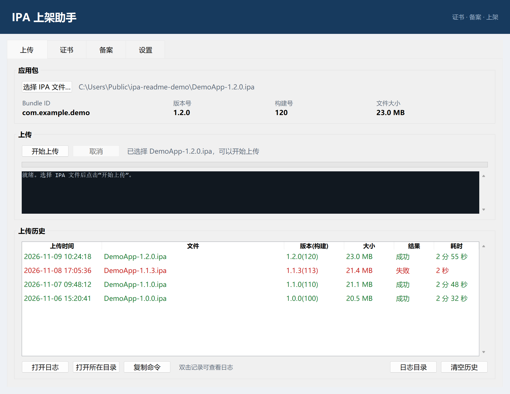
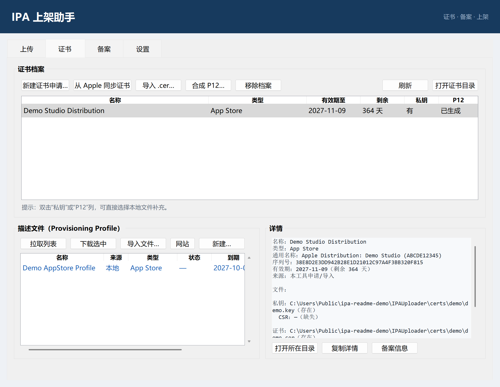
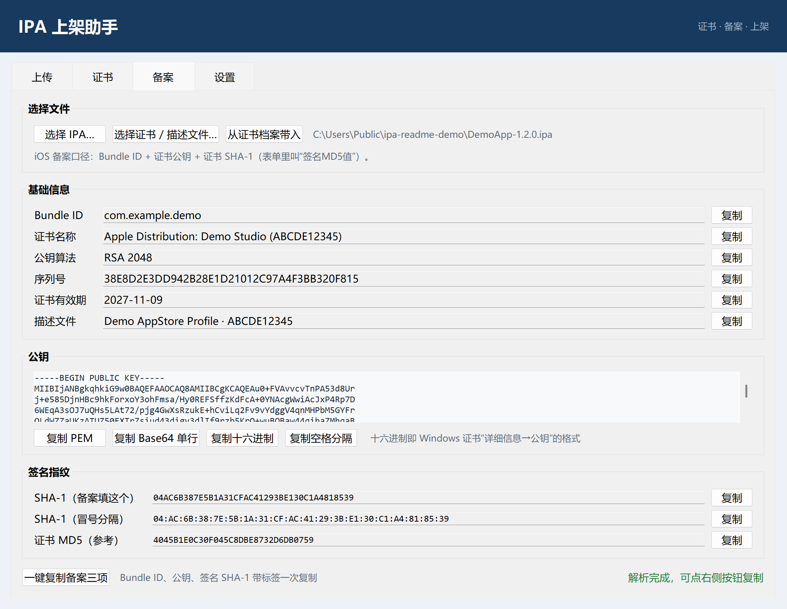

# IPA 上架助手

面向 iOS 应用发布流程的 Windows 桌面工具：管理 Apple 签名证书、生成 App 备案所需信息、通过 App Store Connect API 直接上传 IPA，无需安装 Transporter 或 Xcode。

## 下载

- **Gitee 发行版（国内推荐）**：[最新版](https://gitee.com/fangmeng1988/ipa-uploader/releases/latest)
- **GitHub Releases（海外）**：[最新版](https://github.com/fangmeng1988/ipa-uploader/releases/latest)

首次运行如遇 SmartScreen 提示“未知发布者”，点击“更多信息 → 仍要运行”。

## 功能

### 上传

- 选择 IPA 后自动解析 Bundle ID、版本号、构建号与文件大小
- 通过 App Store Connect API 直传，实时显示进度与日志
- 上传历史、耗时统计、日志查看与命令复制



### 证书

- 新建证书申请（CSR），提交到 Apple 后下载证书
- 从 Apple 同步已有证书，或导入本地 `.cer`
- 合成带中间证书链的 P12，可直接导入 HBuilderX 等打包工具
- 拉取、下载、创建 Provisioning Profile，并与证书档案关联



### 备案

- 直接解析 IPA、`.mobileprovision`、`.cer`、`.p12`，读取签名证书
- 输出 Bundle ID、证书公钥与指纹，支持多种格式一键复制：
  - 公钥：PEM、Base64 单行、连续十六进制、空格分隔十六进制
  - 指纹：SHA-1（连续 / 冒号分隔）、证书 MD5
- “一键复制备案三项”：Bundle ID、公钥、签名 SHA-1 一次复制



### 配置迁移

- 设置页支持导出 / 导入 `.ipak` 配置文件，包含 Key ID、Issuer ID 与 `.p8` 私钥
- 导出时可设置密码：AES-256-GCM 加密；留空则明文保存并提示风险
- 同事导入后即可直接上传，无需逐项手填
- 导入不会覆盖本机“默认 IPA 目录”，覆盖前会自动备份旧 `config.json`

## 快速开始

### 方式一：直接下载

从 [Gitee 发行版](https://gitee.com/fangmeng1988/ipa-uploader/releases/latest) 或 [GitHub Releases](https://github.com/fangmeng1988/ipa-uploader/releases/latest) 下载 `IPAUploader-v1.3.2-win64.zip`，解压后运行 `IPAUploader.exe`。

### 方式二：从源码运行

环境要求：Windows 10 / 11、Python 3.10 及以上。

```bat
pip install -r requirements.txt
start.bat
```

也可以直接运行：

```bat
python app.pyw
```

### 打包为 exe

```bat
build-exe.bat
```

生成 `dist\IPAUploader.exe`（单文件、无控制台窗口）。

## 首次配置（上传功能）

1. 登录 App Store Connect，进入 **用户和访问 → 集成 → App Store Connect API**，创建团队密钥并下载 `.p8` 文件（只能下载一次）。
2. 打开工具的“设置”页，填写 Key ID、Issuer ID，选择 `.p8` 文件并保存。
3. 如果同事已经配置好，也可以让对方导出 `.ipak` 文件，你在“设置 → 配置迁移”中导入即可。
4. 密钥仅保存在本机，不会上传到任何第三方服务。

## 备案填写口径

| 平台 | 公钥 | “签名MD5值”实际填写 |
| --- | --- | --- |
| iOS | 证书中的公共密钥 | 证书 SHA-1（40 位十六进制） |

备案表单中的字段名是“签名MD5值”，但 iOS 平台按官方指引应填写证书的 **SHA-1**。工具中的 MD5 仅作参考。

支持的解析来源：

- **IPA**：读取 `Info.plist` 与 `embedded.mobileprovision`；从 App Store 下载的包会剥离描述文件，此时请改用 `.cer` 或 `.p12`
- **.mobileprovision**：可同时得到 Bundle ID、团队 ID 与签名证书
- **.cer / .crt / .pem**：读取证书公钥与指纹，Bundle ID 需手动填写
- **.p12 / .pfx**：输入导出密码后读取其中证书

## 数据与安全

- 不内置任何 API Key、私钥或证书
- 配置、密钥、证书档案与上传历史均保存在本机 `%APPDATA%\IPAUploader`
- 旧版本数据目录会自动原地兼容，不会移动或覆盖已有数据
- 上传使用 ES256 JWT，访问令牌只存在于内存
- `.ipak` 导出文件包含 API 私钥，请通过可信渠道传输，并在使用后及时删除

## 项目结构

```text
app.pyw            主程序（Tkinter 单文件）
ipa.ico            应用图标
build-exe.bat      PyInstaller 打包脚本
version_info.txt   exe 版本信息
requirements.txt   Python 依赖
img/               README 截图
```

## 依赖

- [cryptography](https://cryptography.io/)：证书解析、CSR 生成、P12 合成与 JWT 签名

## 作者

fangmeng · [github.com/fangmeng1988](https://github.com/fangmeng1988)

## 许可证

本项目采用 [MIT](LICENSE) 许可证。

## 说明

- 仅支持 Windows。
- 请遵守 Apple 开发者协议，仅上传你有权发布的应用。
